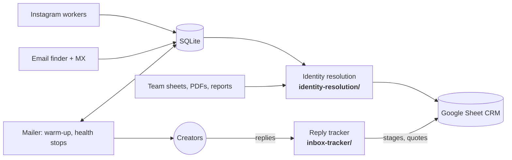

# CreatorOps: selected source

CreatorOps is an influencer-marketing pipeline I designed and built end to end. It finds creators, finds out how to reach them, emails them from a real mailbox, and keeps a Google Sheet CRM up to date by reading their replies. The full product is private. This repo holds two self-contained parts of it, with their tests, and an architecture write-up.

**What the full system does**

- **Discovery:** crawls Instagram from owned accounts at a human pace, steering towards a follower band, a set of niches and a home country, and demoting crawl branches that drift.
- **Enrichment:** finds contact emails on bios, link-in-bio pages and creators' own sites, scores how much each one can be trusted, checks MX, and pulls YouTube stats.
- **Outreach:** sends personal, plain-text email from Gmail or Google Workspace. Sending warms up over days, stays within working hours, and pauses itself on bounces or spam complaints.
- **CRM:** merges collected creators with the team's spreadsheets, PDF rosters and marketplace reports into one row per person in a shared Google Sheet.
- **Reply tracking:** a 15-minute Apps Script job inside the mailbox reads replies, moves each creator through the deal stages and copies their quoted rates into the sheet.

It runs on a single PC or a small VPS: Node 22 with built-in SQLite, Playwright with Chrome, Python for the CRM build, and Google Apps Script.



## In this repo

### [`inbox-tracker/`](inbox-tracker): turning a sales inbox into CRM updates

Every 15 minutes it reads the mailbox and, for each conversation:

- **Finds the creator:** by any email address in the thread, then by an Instagram link or @handle in the reply, then by fuzzy-matching the sender's name to handles ("Asha Rao (Official)" ↔ `@iamasharao`).
- **Strips quoted history:** including Gmail's wrapped "On … wrote:" lines.
- **Classifies the reply:** Do not contact, Not interested, Quote received, Interested or Replied.
- **Extracts rates per deliverable** from free text, in the formats Indian creators actually use: `25k`, `₹1,50,000`, `2.7 L`, `4 Lakhs`, `20,000/-`. It rejects phone numbers, years and durations, and carries context between lines ("Ad rights 1 month 10k ↵ 12 months 80k").
- **Writes back safely:** statuses only move forward, the team's own stages are never touched, and quotes only fill empty cells.

### [`identity-resolution/`](identity-resolution): one row per person, across messy sources

- **Merges records** from scraped profiles, hand-made sheets, PDF rosters and marketplace exports by Instagram handle, marketplace username, YouTube channel, email and name.
- **Never merges two different handles,** even when they share an email, because talent agencies manage many creators from one address.
- **Keeps IDs stable across rebuilds:** a person keeps their ID even as later runs learn more keys for them, so the team's sheet never reshuffles.

### [`docs/ARCHITECTURE.md`](docs/ARCHITECTURE.md)

Data flow, trust boundaries (localhost-only dashboard, token-protected Sheet web app, rate-limited owner page) and why each piece was built the way it was.

## Run the tests

```sh
npm test        # Node 20+ and Python 3.10+, no dependencies
```

Every name, handle and reply in the tests is invented.

## Not included

The crawler, email discovery, mailer, dashboard and deployment tooling stay private. This repo shows how the system is built, not a copy of it.

## License

All rights reserved. You may read this code for evaluation. Copying, modifying or redistributing it is not permitted. See [LICENSE](LICENSE).
